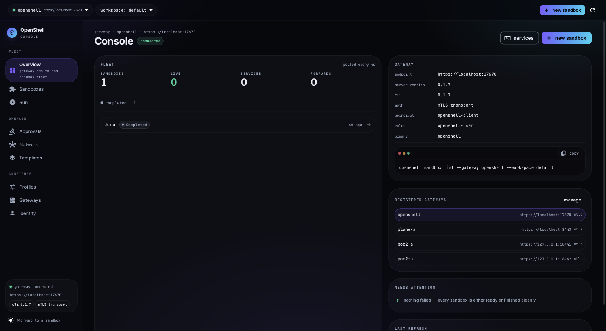
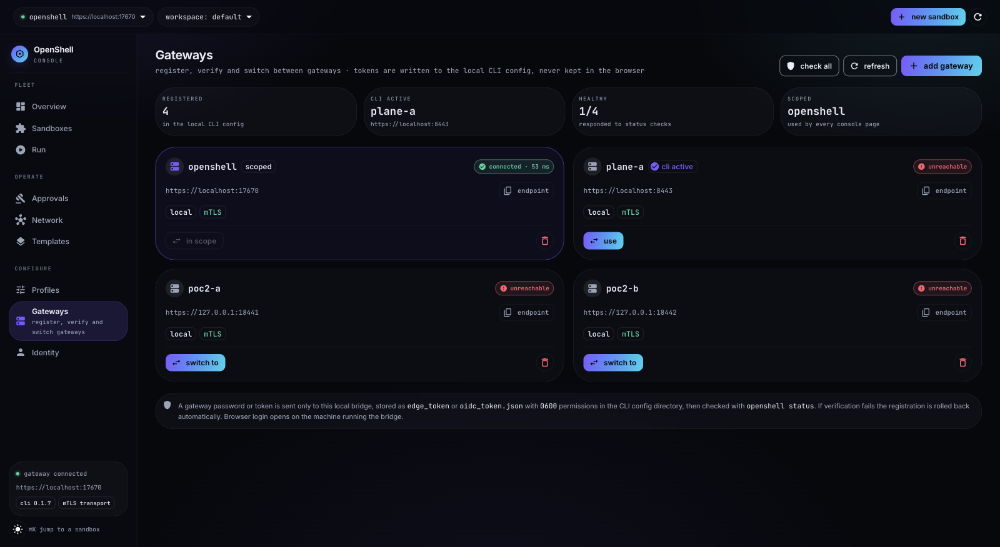
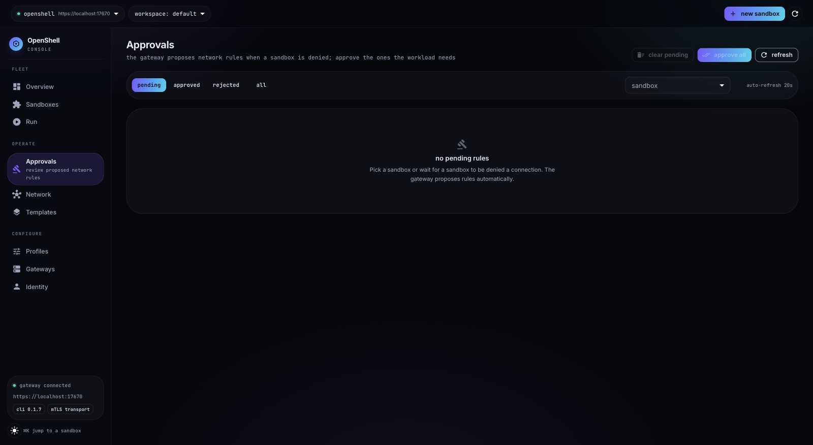
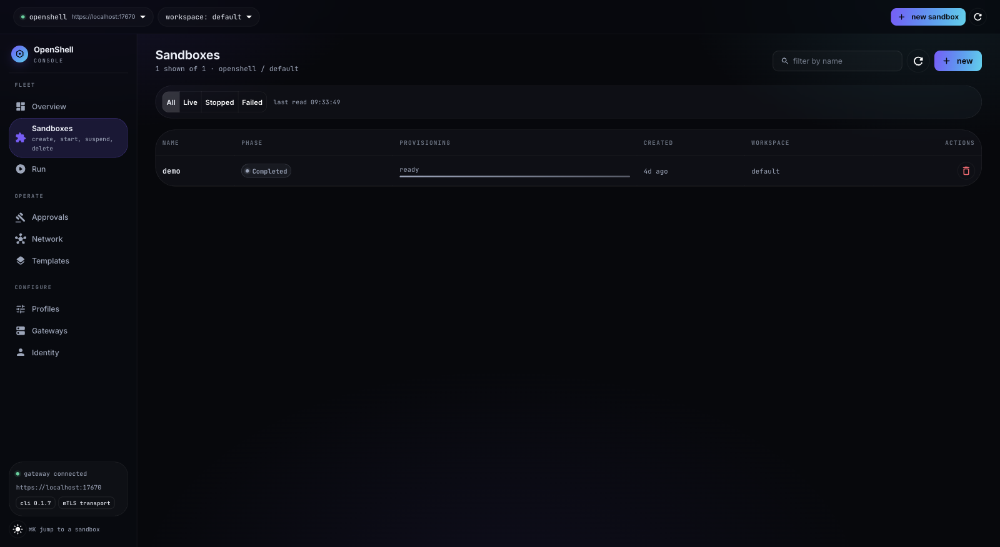
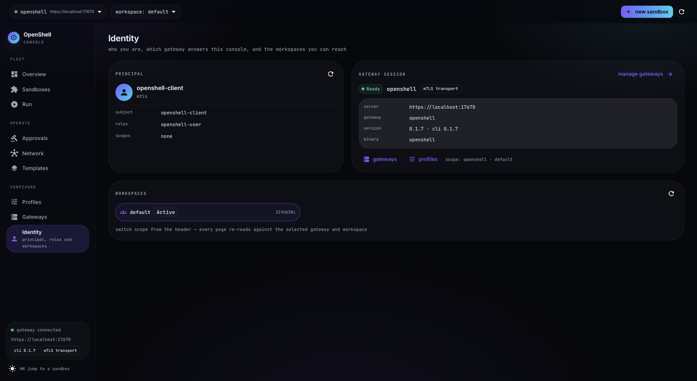

# OpenShell Console

A local web console for the [OpenShell](https://github.com/laik/openshell) sandbox runtime.
React 19 + TypeScript + MUI v9, with an "AI console" visual language: near-black canvas,
violet→cyan accents, glass panels, and monospace for every identifier the gateway returns.
Fonts (Inter + JetBrains Mono) are bundled locally, so the console renders identically offline.



## Why there is a bridge

The OpenShell gateway speaks gRPC with mutual TLS, and the client certificate lives in the
CLI's config. A browser cannot present it, so the console ships a small local bridge
(`server/`, plain Node, no build step) that:

- translates each HTTP call into an `openshell … -o json` invocation and returns the parsed JSON;
- parses the text-only surfaces (`openshell logs`, `service expose`, `settings get`);
- opens a WebSocket that runs `openshell sandbox exec <name> --tty` so the browser gets a
  real PTY (xterm.js) inside the sandbox.

Everything runs as **your** CLI identity — the bridge never stores provider credentials. Optional
gateway bearer/OIDC tokens are written into the same CLI config directory the CLI uses, so the
CLI can keep using them after the console is closed.

```
browser ──HTTP/WS──▶ bridge (127.0.0.1:8787) ──spawn──▶ openshell CLI ──mTLS──▶ gateway
```

## Requirements

- Node.js ≥ 22.6 (runs the TypeScript bridge natively; tested on Node 25)
- `openshell` on `PATH` (tested with CLI 0.1.7) and a reachable gateway
  (`openshell status` should report `connected`)

## Quick start

```bash
npm install
npm run dev          # bridge :8787 + Vite :5273
open http://localhost:5273
```

Production single process:

```bash
npm run build        # tsc + vite build → dist/
npm start            # bridge serves dist/ and the API on 127.0.0.1:8787
open http://127.0.0.1:8787
```

Environment knobs:

| Variable | Default | Meaning |
| --- | --- | --- |
| `OPENSHELL_BIN` | `openshell` | CLI binary to invoke |
| `OPENSHELL_UI_PORT` | `8787` | bridge port |
| `OPENSHELL_UI_HOST` | `127.0.0.1` | bridge bind address |
| `OPENSHELL_UI_API` | `http://127.0.0.1:8787` | bridge target used by the Vite dev proxy |
| `OPENSHELL_UI_CONFIG_DIR` | `$XDG_CONFIG_HOME/openshell` or `~/.config/openshell` | where the bridge writes edge/OIDC tokens |

## What you can do

| Page | Capabilities |
| --- | --- |
| **Overview** | gateway health/identity, fleet metrics per phase, recent sandboxes, failures that need attention |
| **Sandboxes** | search + phase filters, create (image or template, cpu/memory/gpu, providers, env), start / stop / suspend / resume / delete with phase-aware actions |
| **Sandbox detail** | identity + conditions + provisioning timeline, `exec` (non-interactive, shell semantics), live PTY terminal, parsed logs with level/source filters, policy filesystem view + revisions, services & forwards for that sandbox, raw JSON |
| **Run** | pick a sandbox, start/resume it if needed, run a command through `bash -lc`, and keep a session history of exit codes and output |
| **Approvals** | the gateway's proposed network rules (`openshell rule`): pending / approved / rejected views, confidence and endpoints, approve, reject with a reason, approve-all, clear, and rule history |
| **Network** | exposed services (publish a sandbox loopback port) and background port forwards |
| **Templates** | list/register/delete workload templates |
| **Profiles** | browse provider profiles with full describe/export JSON or YAML, lint or import (paste, file, URL), delete custom profiles; create, update and delete provider configs with credentials kept in the gateway |
| **Gateways** | multiple gateways with per-gateway health checks, scope switching, browser login/logout, token update, removal, and add-by-token for edge/OIDC gateways (verified with `openshell status`, rolled back on failure) |
| **Identity** | current principal, scoped gateway session, roles and workspaces |

Scope selectors in the header (gateway + workspace) apply to every page and persist in
`localStorage`. `⌘K` / `Ctrl-K` opens a jump palette across sandboxes. On narrow screens the
scope selectors live in the navigation drawer.

Scope selectors in the header (gateway + workspace) apply to every page and persist in
`localStorage`. `⌘K` / `Ctrl-K` opens a jump palette across sandboxes.

## Screenshots

| Gateways | Approvals | Profiles | Run |
| --- | --- | --- | --- |
|  |  |  |  |

| Sandboxes | Terminal | Logs | Identity |
| --- | --- | --- | --- |
|  |  |  |  |

### Adding a gateway with a token

1. Open **Gateways → add gateway**.
2. Choose **Edge / cloud (token)** (Cloudflare Access or an edge proxy) or **OIDC**.
3. Paste the bearer/access token, then keep *verify before keeping* enabled.
4. The bridge registers the gateway with `openshell gateway add`, writes `edge_token` or
   `oidc_token.json` with `0600`, and runs `openshell status`. If the status check fails the
   registration is removed again and the error is shown in the dialog.

Local mTLS, remote-over-SSH and plaintext HTTP gateways are added the same way without a token.
Browser login/logout remains available per gateway for edge and OIDC registrations.

## HTTP API (bridge)

All routes accept `?gateway=<name>&workspace=<name>` unless noted.

```
GET    /api/context                         status, whoami, gateways, workspaces, CLI version
GET    /api/sandboxes[?all=1]               list
POST   /api/sandboxes                       create
GET    /api/sandboxes/:name                 detail (+policy, providers, services)
DELETE /api/sandboxes/:name                 delete
POST   /api/sandboxes/:name/start|stop|suspend|resume
POST   /api/sandboxes/:name/exec            { command }   → { ok, stdout, stderr, exit_code }
POST   /api/sandboxes/:name/run             { command, start? } → exec result + phase
GET    /api/sandboxes/:name/logs            ?lines&level&source&since
GET    /api/sandboxes/:name/ssh             ssh-config text
GET    /api/sandboxes/:name/policy          policy revisions
GET    /api/rules                           ?status=pending|approved|rejected (all live sandboxes)
GET    /api/sandboxes/:name/rules           parsed network rules
GET    /api/sandboxes/:name/rules/history   rule history
POST   /api/sandboxes/:name/rules/:chunk/approve
POST   /api/sandboxes/:name/rules/:chunk/reject   { reason }
POST   /api/sandboxes/:name/rules/approve-all     { includeSecurityFlagged }
DELETE /api/sandboxes/:name/rules           clear pending rules
GET    /api/services                        list exposed services
POST   /api/services                        { sandbox, port, service? }
DELETE /api/services/:sandbox/:service      `_` = unnamed service
GET    /api/forwards                        list forwards
POST   /api/forwards                        { port, sandbox }
DELETE /api/forwards/:port/:sandbox
GET    /api/templates                       list
POST   /api/templates                       create
DELETE /api/templates/:name
GET    /api/profiles                        provider profiles
GET    /api/profiles/:id                    describe
GET    /api/profiles/:id/export             ?format=yaml|json
POST   /api/profiles/lint                   { content | url, fileName?, global? }
POST   /api/profiles/import                 { content | url, fileName?, global? }
DELETE /api/profiles/:id                    ?global=1
GET    /api/providers                       list provider configs
POST   /api/providers                       create
PATCH  /api/providers/:name                 update credentials/config
DELETE /api/providers/:name
GET    /api/workspaces                      workspaces
GET    /api/settings/:name                  settings get (raw text)
GET    /api/gateways[?probe=1]              registered gateways, optionally health-checked
GET    /api/gateways/:name                  local metadata + token kind
GET    /api/gateways/:name/health           openshell status
POST   /api/gateways                        register + optionally store token + verify
POST   /api/gateways/:name/select
POST   /api/gateways/:name/login|logout
POST   /api/gateways/:name/token            { token, verify? }
POST   /api/gateways/:name/forget-tokens
DELETE /api/gateways/:name
WS     /api/terminal?name&cols&rows&shell    JSON frames {type: input|data|exit|error}
```

## Project layout

```
server/
  cli.ts        spawn wrapper, ANSI stripping, quote-aware tokenizer, error shaping
  index.ts      HTTP routes, static serving, PTY WebSocket, rule/profile endpoints
  gateways.ts   local gateway metadata, edge/OIDC token storage, status probes
  ruleparse.ts  parser for the human-readable `openshell rule get|history` output
  logparse.ts   parser for `openshell logs` (no JSON mode)
src/
  api/          typed client + payload types (field names match `-o json`)
  components/   AppShell, Terminal (xterm), LogViewer, shared Panels/chips
  pages/        Overview, Sandboxes, SandboxDetail, Run, Approvals, Network,
                Templates, Profiles, Gateways, Access
  theme.ts      INK palette, MUI theme, typography, gradient accents
```

## Security notes

- The bridge binds `127.0.0.1` and has **no authentication layer of its own** — it inherits
  your CLI's mTLS identity and can run arbitrary commands in your sandboxes (exec/terminal).
  Do not expose the port to a network you do not trust, and do not put it behind a public proxy.
- `exec`, **Run** and the terminal are intentionally powerful; treat them like a local shell.
- Gateway registration commands modify your local CLI config (`gateway add/select/remove`).
  Pasted edge/OIDC tokens travel only from the browser to this loopback bridge, are written with
  `0600` permissions alongside the CLI's own gateway metadata, and are never kept in
  `localStorage` or any browser storage.
- Token updates are verified with `openshell status`; adding a gateway with verification enabled
  rolls the registration back if the check fails.
- The console never reads back raw provider secrets; **Profiles** only shows profile metadata and
  provider config names/credential keys. Credential values are sent to the gateway and are not
  displayed again.

## 中文快速开始

```bash
cd openshell-ui
npm install
npm run dev
# 浏览器打开 http://localhost:5273
```

要求：本机已安装 `openshell`（0.1.7 测试通过）且 `openshell status` 显示 `connected`；
Node.js 建议 22.6+（直接运行 TypeScript 桥接服务，无需编译）。
生产模式：`npm run build && npm start`，然后访问 http://127.0.0.1:8787。

主要页面：

- **Gateways**：多网关管理。可填写 edge/OIDC token 后添加，添加时用 `openshell status`
  验证，失败自动回滚；支持健康检查、切换 scope、浏览器登录/登出、更新 token、删除。
- **Approvals**：审批网关提出的网络规则（`openshell rule`），支持单条批准/拒绝、
  全部批准、清空待审批和历史记录。
- **Profiles**：查看/导出 provider profile（JSON/YAML）、lint/导入（粘贴、文件、URL）、
  删除自定义 profile；创建、更新、删除 provider 配置。
- **Run**：选择沙箱，必要时自动 start/resume，执行一条命令并查看退出码与输出。
- **Identity**：当前身份、scope 内网关会话、工作区列表。

字体（Inter 与 JetBrains Mono）已本地打包，离线也能保持一致排版。

> 桥接服务监听 127.0.0.1、不额外鉴权，使用的是你本机 CLI 的 mTLS 身份，且能执行任意
> 沙箱命令（exec / 终端）。不要把端口暴露到不受信任的网络。
