# OpenShell Console

A local web console for the [OpenShell](https://github.com/laik/openshell) sandbox runtime.
React 19 + TypeScript + MUI v9, with an "AI console" visual language: near-black canvas,
violet→cyan accents, glass panels, and monospace for every identifier the gateway returns.
Fonts (Inter + JetBrains Mono) are bundled locally, so the console renders identically offline.

[](LICENSE)
[](https://github.com/laik/openshell-ui/actions/workflows/ci.yml)
[](https://nodejs.org)

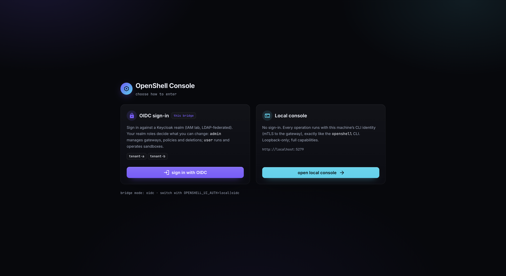

## Features

| Area | What you get |
| --- | --- |
| **Welcome / chooser** | Landing page to pick OIDC sign-in or the local console; reachable from either console's header chip |
| **Overview** | Gateway health/identity, fleet metrics per phase, recent sandboxes, failures that need attention, sandbox settings panel |
| **Sandboxes** | Search + phase filters, create (image or template, cpu/memory/gpu, providers, env), start / stop / suspend / resume / delete with phase-aware actions |
| **Sandbox detail** | Identity + conditions + provisioning timeline, observed **startup command**, `exec`, live PTY terminal (**startup** = attach the canonical main process, **shell** = the sandbox's own `$SHELL`; sessions survive page switches), parsed logs, **network policies** view, dynamic policy editing, filesystem view + revisions, services & forwards, raw JSON |
| **Run** | Start/resume a sandbox and run one command; exit code, duration, session history, startup-command shortcut, practical tips |
| **Approvals** | The gateway's proposed network rules (`openshell rule`): pending/approved/rejected views, confidence + endpoints, approve, reject with reason, approve-all, clear, history, nav badge |
| **Policy editing** | Incremental `policy update` (endpoint presets, option checkboxes, L7 allow rows, dry-run) and `policy set` (filesystem merge or full YAML); **removal** at three levels (whole rule, endpoint, single L7 matcher) with confirm + command preview; every dialog pins the exact `openshell` command it will run |
| **Network** | Exposed services (publish a sandbox loopback port) and background port forwards |
| **Templates** | List/register/delete workload templates |
| **Profiles** | Provider profiles: describe, export JSON/YAML, lint, import (paste/file/URL) with *update-existing* fallback when the id is taken, delete; provider configs: create/update/delete with profile-declared credential keys, template insert and key validation, credentials kept in the gateway |
| **Gateways** | Multi-gateway: per-gateway health checks, scope switching, browser login/logout, token update, removal, add-by-token (edge/OIDC) with verification + automatic rollback, OIDC password-grant token fetch |
| **Identity** | Current principal, scoped gateway session, roles, workspaces |
| **Auth** | Two full modes: **local** (loopback, CLI mTLS identity, no sign-in) and **OIDC** (Keycloak realms via password grant, or **Microsoft Entra ID** via device-code flow; role-gated mutations, HttpOnly sessions, guarded API + terminal socket) |
| **Command hints** | Every action shows the exact `openshell` command behind it: hover any control (including a disabled one) for its command line, destructive actions print it inside the confirm dialog, and create/edit dialogs preview it live as you type — including the multi-command cases the bridge runs (endpoint + L7 policy merge, create-from-template with resource overrides, `run` on a stopped sandbox). Built from `src/lib/cli.ts`, a mirror of the argv in `server/index.ts`; actions with no CLI surface (storing a gateway token, switching the console role) show nothing rather than inventing one |

Scope selectors in the header (gateway + workspace) apply to every page and persist in
`localStorage`. `⌘K` / `Ctrl-K` opens a jump palette across sandboxes. On narrow screens the
scope selectors live in the navigation drawer.

## Quick demo (5 minutes)

```bash
npm install
npm run demo            # bridge :8787 + Vite :5273, local mode
open http://localhost:5273
```

Pick **Local console** on the welcome page and follow the walkthrough in
**[docs/DEMO.md](docs/DEMO.md)** — create a sandbox, attach its startup process in the
terminal, trigger and approve a network rule, add policy from a preset, expose a service.

OIDC demo (Keycloak + OpenLDAP multi-tenant lab, role-based permissions):

```bash
cd ~/docs/iam-lab && docker-compose up -d     # IAM lab: realms tenant-a / tenant-b
npm run demo:oidc                             # console with OIDC sign-in on :5273
```

Sign in with `admin / admin123` (admin role) or `user1 / user1123` (user role) per realm.
Full steps, accounts and troubleshooting: **[docs/DEMO.md](docs/DEMO.md)**.

Microsoft Entra ID demo (device-code sign-in, MFA-friendly, no client secret):

```bash
export OPENSHELL_UI_ENTRA_TENANT=<tenant-id-or-domain>
export OPENSHELL_UI_ENTRA_CLIENT_ID=<app-registration-client-id>
npm run demo:entra                            # OIDC-mode console on :5273 with Entra enabled
```

On the welcome page pick **Microsoft Entra ID → sign in with device code**, open the
verification page, enter the code and approve with your work/school account. App roles
(`admin` / `user`) decide permissions exactly like Keycloak realm roles. Setup steps:
**[docs/DEMO.md](docs/DEMO.md)**.

Production single process:

```bash
npm run build
npm start               # add OPENSHELL_UI_AUTH=oidc to require sign-in
open http://127.0.0.1:8787
```

Docker image (multi-arch, checksum-verified OpenShell CLI, non-root, healthcheck):

```bash
docker build -t openshell-console:local .
docker run --rm -p 8787:8787 \
  -e OPENSHELL_UI_AUTH=oidc \
  -e OPENSHELL_UI_ENTRA_TENANT=<tenant> -e OPENSHELL_UI_ENTRA_CLIENT_ID=<client> \
  -e OPENSHELL_UI_LOCAL_TOKEN=<operator-token> \
  openshell-console:local
```

The image binds `0.0.0.0`, so the fail-closed invariant applies: without a credential
path the container refuses to start. Mount gateway CLI credentials at
`/home/console/.config/openshell` (or set `XDG_CONFIG_HOME`) and TLS material via
Secrets — see **[docs/DEPLOY-K8S.md](docs/DEPLOY-K8S.md)**.

## Why there is a bridge

The OpenShell gateway speaks gRPC with mutual TLS, and the client certificate lives in the
CLI's config. A browser cannot present it, so the console ships a small local bridge
(`server/`, plain Node, no build step) that:

- translates each HTTP call into an `openshell … -o json` invocation and returns the parsed JSON;
- parses the text-only surfaces (`openshell logs`, `rule get/history`, `settings get`,
  `template create`);
- observes each sandbox's canonical main process to display its startup command;
- opens a WebSocket that either attaches the main process (`sandbox connect`) or runs the
  sandbox user's own shell over `sandbox exec --tty`, so the browser gets a real PTY (xterm.js);
- optionally authenticates operators via OIDC and enforces realm roles.

Everything runs as **your** CLI identity in local mode. In OIDC mode the console operator is
authenticated separately; the gateway side keeps using whatever credentials it needs.

```
browser ──HTTP/WS──▶ bridge (127.0.0.1:8787) ──spawn──▶ openshell CLI ──mTLS──▶ gateway
                        │
                        └──OIDC password grant──▶ Keycloak (iam-lab realms, optional)
```

## Authentication: three credential paths, one session model

Every credential path yields the same server-side session (HttpOnly cookie, tokens never
reach browser storage, lazy refresh) and the same role gating on every API route and the
terminal WebSocket. Unauthenticated calls get `401`; non-admin calls to admin-only
operations get `403`. The welcome page offers **only the paths that are configured**:

- **OIDC authorization code + PKCE** — offered when `OPENSHELL_UI_AUTH=oidc`. The operator is
  redirected to the IdP's own login page (the [iam-lab](https://github.com/laik/openshell-ui/blob/main/docs/DEMO.md)
  Keycloak realms in the demo lab, LDAP-federated and multi-tenant; `lab-cli` public client).
  Issuers come only from `OPENSHELL_UI_OIDC_ISSUERS` — there are no built-in defaults, so an
  unconfigured bridge offers no OIDC path. The
  console never sees a password: MFA, SSO, conditional access and federation happen at the
  IdP. The bridge exchanges the code server-side with the PKCE verifier and **verifies both
  tokens** — RS256 signature against the issuer JWKS (kid-rotation aware), issuer, audience,
  expiry and the flow nonce. Refreshed tokens are re-verified the same way.
- **Microsoft Entra ID** — offered when `OPENSHELL_UI_ENTRA_TENANT` and
  `OPENSHELL_UI_ENTRA_CLIENT_ID` are set. Primary path is the same authorization code + PKCE
  redirect ("continue to Microsoft sign-in"); a **device-code flow** is available as the
  alternative for input-constrained sessions (code approved at `microsoft.com/devicelogin`).
  Public client, no secret; MFA and conditional access work as configured in the tenant.
  Register the bridge callback (`<origin>/api/auth/oidc/callback`) as a public-client
  redirect URI in the app registration — `scripts/entra-setup.mjs` does this for the local
  origins; add your production origin there too (or set `OPENSHELL_UI_PUBLIC_URL`).
- **Local operator credentials** — the production replacement for loopback trust, offered
  when a token or client CA is provisioned:
  - **mTLS**: set `OPENSHELL_UI_TLS_CERT` / `OPENSHELL_UI_TLS_KEY` (the bridge terminates TLS
    itself) plus `OPENSHELL_UI_TLS_CLIENT_CA`. A client certificate verified against that CA
    *is* the credential: the session is keyed by the cert fingerprint, the identity is the
    cert CN, and omitting/revoking the cert ends access. Works for API and terminal alike.
  - **Token**: `OPENSHELL_UI_LOCAL_TOKEN` or `OPENSHELL_UI_LOCAL_TOKEN_FILE` (k8s Secret
    mount). `POST /api/auth/local` checks it in constant time with a per-source rate limit
    (5 failures/min) and issues an admin session. The token is never logged or echoed.

  Both local paths grant the `admin` role — they are operator/bot credentials, not end-user
  accounts.

**Fail-closed invariant.** Anonymous access exists only as a development convenience, when
*all* of: mode `local`, loopback bind, no local credential configured, and
`OPENSHELL_UI_REQUIRE_AUTH` unset. A non-loopback bind with no credential path at all
**refuses to start** rather than serving an open proxy to the gateway.
`OPENSHELL_UI_REQUIRE_AUTH=1` disables the convenience even on loopback.

Sessions are in-memory: run a single replica (PTY terminal sessions are stateful anyway);
token/CA changes are picked up at startup, so rotate with a rollout restart. Kubernetes
wiring (same-namespace gateway, Secrets, cert-manager, NetworkPolicy):
**[docs/DEPLOY-K8S.md](docs/DEPLOY-K8S.md)**.

Roles map to console permissions (Keycloak **realm roles**, Entra **app roles** — both are
matched against `OPENSHELL_UI_ADMIN_ROLE`, default `admin`):

| Role | Allowed |
| --- | --- |
| `admin` | everything, including gateway management, policy changes, settings, approvals, services/forwards and all deletions |
| `user` | reads, sandbox create/start/stop/suspend/resume, exec, Run, terminal |

Signing out clears the session server-side and the cookie (an mTLS identity re-authenticates
for as long as the certificate is presented — that is the point of cert-based access). When
two consoles run side by side in development, the welcome footer links them to each other
(`OPENSHELL_UI_LOCAL_URL` / `OPENSHELL_UI_OIDC_URL`).

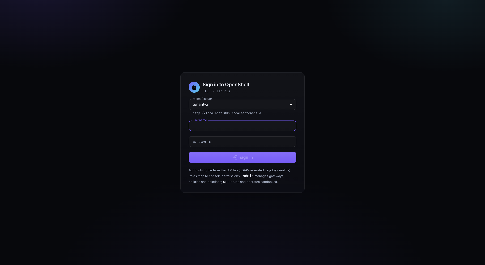

Gateway registration also understands OIDC: in **Gateways → add gateway → OIDC** you can paste
an access token, fetch one with a password grant (lab convenience), or fetch one with an
**Entra device code** scoped to the gateway's audience — while local mTLS gateways keep
working unchanged.

## Enterprise onboarding: connect your IdP, then start

Only configured credential paths appear on the sign-in page, and a bridge with no credential
path at all refuses to start outside loopback. Pick the paths you need, register the callback
URI at each IdP, then start with the matching command.

### 1. Microsoft Entra ID

**Automated (recommended).** With a tenant admin account:

```bash
brew install azure-cli && az login          # one interactive sign-in
node scripts/entra-setup.mjs                # idempotent; prints env exports + test passwords
```

The script provisions: the `openshell-console` app registration (single tenant), *allow public
client flows*, `admin` / `user` app roles, two test users with role assignments, the
`access_as_user` API scope + self resource permission (needed for the `roles` claim), and the
public-client **redirect URIs** `http://localhost:{5273,8787,8788}/api/auth/oidc/callback`
(plus `127.0.0.1` variants). Credentials land in gitignored `.entra-test-accounts.json`.
On a disposable test tenant whose security defaults block device-code sign-in, re-run with
`--disable-security-defaults` (test tenants only).

**Manual (Entra admin center)** if you prefer the portal:

1. *App registrations → New registration* — single tenant, no redirect URI yet.
2. *Authentication → Advanced settings → Allow public client flows = Yes*.
3. *Authentication → Add a platform → Mobile and desktop applications* — add
   `<origin>/api/auth/oidc/callback` for **every origin the console is served from**
   (dev vite port, bridge port, production URL).
4. *App roles* — create `admin` and `user` (value = role name); assign users under
   *Enterprise applications → your app → Users and groups*.
5. Note the **Directory (tenant) ID** and **Application (client) ID**.

**Start:**

```bash
export OPENSHELL_UI_ENTRA_TENANT=<tenant-id-or-domain>
export OPENSHELL_UI_ENTRA_CLIENT_ID=<client-id>
npm run demo:entra                 # dev: bridge :8787 + vite :5273
# production single process instead:
npm run build && OPENSHELL_UI_AUTH=oidc npm start
```

Sign-in: welcome page → **Entra ID → continue to Microsoft sign-in** (authorization code +
PKCE; MFA/conditional access happen in your tenant). **List my tenants first** authenticates
at the Microsoft `organizations` endpoint, lists the tenants your account belongs to
(ARM `/tenants`), and lets you pick one before the session is minted in that tenant — the
Azure CLI/portal pattern. The app registration must be multi-tenant for this path
(`scripts/entra-setup.mjs` sets it); sessions are restricted to
`OPENSHELL_UI_ENTRA_ALLOWED_TENANTS` (default: the configured tenant). *Use a device code
instead* is available for input-constrained sessions.

### 2. OIDC — Keycloak or any compliant IdP

**IdP side:** create a **public client** (no secret) with the authorization-code flow and
PKCE (S256) enabled, and register `<origin>/api/auth/oidc/callback` as a valid redirect URI
for every console origin. Map realm roles to `admin` / `user` (or rename the admin role with
`OPENSHELL_UI_ADMIN_ROLE`). There are **no built-in issuer defaults** — an unset allowlist
means no OIDC path.

**Console side:**

```bash
export OPENSHELL_UI_AUTH=oidc
export OPENSHELL_UI_OIDC_ISSUERS="Production=https://idp.example.com/realms/prod"
export OPENSHELL_UI_OIDC_CLIENT_ID=openshell-console
npm run build && npm start         # serves dist/ + API on :8787
```

Multiple issuers: comma-separated `url` or `Display Name=url` entries (a selector appears);
a single entry renders as a static label. Operators sign in on the **IdP's own login page** —
the console never sees passwords.

**Lab demo:** `cd ~/docs/iam-lab && docker-compose up -d`, then `npm run demo:oidc` (the script
injects the lab realms; enter `admin / admin123` or `user1 / user1123` on the Keycloak page).
For your own Keycloak client, register the callback via the admin API, e.g.:

```bash
# token: master realm admin-cli password grant; then per realm:
curl -X PUT -H "Authorization: Bearer $T" -H 'content-type: application/json' \
  -d '{"redirectUris":["http://localhost:5273/api/auth/oidc/callback","https://console.example.com/api/auth/oidc/callback"]}' \
  http://localhost:8080/admin/realms/<realm>/clients/<client-uuid>
```

### 3. Operator credentials — bots, CI, break-glass

```bash
export OPENSHELL_UI_LOCAL_TOKEN=$(openssl rand -base64 32)   # or _FILE=/run/secrets/token
# and/or mTLS:
export OPENSHELL_UI_TLS_CERT=/tls/tls.crt OPENSHELL_UI_TLS_KEY=/tls/tls.key
export OPENSHELL_UI_TLS_CLIENT_CA=/client-ca/ca.crt
```

Token sign-in is constant-time checked and rate limited (5 failures/min/source); a verified
client certificate authenticates automatically (CN = identity). Both grant `admin`. In k8s
mount the token from a Secret and issue client certs from your cluster CA —
**[docs/DEPLOY-K8S.md](docs/DEPLOY-K8S.md)**.

**Where the operator token comes from.** It is *not* issued by any IdP. It is a
**pre-shared secret you generate at deploy time** and hand to the bridge; the bridge reads it
once at startup (env or `_FILE`) and keeps it in memory. There is no issuer, no signature, no
expiry — possession equals admin. That makes it the k8s-style service-to-service credential
for bots, CI and break-glass access, while humans sign in through OIDC/Entra:

| | Operator token | OIDC / Entra session token |
| --- | --- | --- |
| Issuer | you, at deploy time (`openssl rand`) | Keycloak / Microsoft Entra |
| Format | opaque shared secret | signed JWT (JWKS-verified server-side) |
| Identity | shared `local-operator` (or cert CN for mTLS) | real user (`preferred_username` / UPN) |
| Expiry / MFA | none / none | token expiry + refresh; MFA at the IdP |
| Revocation | change the Secret + rollout restart | IdP-side revocation / session logout |
| Intended for | automation, CI, emergency access | people |

Production lifecycle:

```bash
openssl rand -hex 32 > operator-token                       # generate once
kubectl create secret generic console-operator-token --from-file=token=operator-token
# mount the Secret at /run/secrets and set OPENSHELL_UI_LOCAL_TOKEN_FILE=/run/secrets/token
kubectl rollout restart deployment/console                  # rotate / revoke: new Secret + restart
```

Distribute the value only through your secret manager to the automation/break-glass channels
that need it. Because every holder shares the `local-operator` identity, audit logs cannot
attribute actions to individual people on this path — keep it for machines and emergencies,
and use OIDC/Entra (real identity + MFA + post-login role selection) for humans. The console
deliberately does not issue its own login tokens: that would mean rebuilding an IdP
(user store, JWT issuance, expiry, revocation) which your organization already operates.
Demo tokens shipped in examples/scripts are throwaway values — replace them in any real
deployment.

**Where the mTLS certificates come from.** Keep two mTLS relationships apart:

- *Console ↔ operator* (this section): the bridge terminates TLS with `TLS_CERT/KEY` and
  verifies client certs against `TLS_CLIENT_CA` — a PKI **you** operate for console access
  (test PKI commands in [docs/DEMO.md](docs/DEMO.md) §4.2; cert-manager in production).
- *CLI ↔ gateway*: the `openshell` CLI presents its own client cert
  (`~/.config/openshell/gateways/<name>/mtls/{ca.crt,tls.crt,tls.key}`), provisioned by the
  gateway (local gateways generate it; remote/cluster gateways' admins distribute it). The
  console inherits that identity by mounting the same files as a Secret in k8s — extraction
  and mount commands, plus the option to reuse the gateway CA as the console client CA
  (one PKI, one privilege domain), are in
  **[docs/DEPLOY-K8S.md](docs/DEPLOY-K8S.md) §2b**.

### 4. Start matrix

| Scenario | Command | Notes |
| --- | --- | --- |
| Local dev, no sign-in | `npm run demo` | loopback-only convenience; disabled by any credential or non-loopback bind |
| Lab OIDC demo | `npm run demo:oidc` | needs iam-lab; script injects lab issuers |
| Entra dev | exports above + `npm run demo:entra` | add `OPENSHELL_UI_LOCAL_TOKEN` for the operator card |
| All three paths | exports above + `OPENSHELL_UI_LOCAL_TOKEN=…` + `npm run demo:all` | OIDC (lab issuers) + Entra + operator token together |
| Production, one process | `npm run build && OPENSHELL_UI_AUTH=oidc npm start` | bridge serves `dist/` + API on :8787 |
| Docker | `docker build -t openshell-console .` then `docker run -p 8787:8787 -e …` | binds 0.0.0.0 → a credential path is mandatory |
| Kubernetes | see [docs/DEPLOY-K8S.md](docs/DEPLOY-K8S.md) | ConfigMap issuers, Secrets, cert-manager, NetworkPolicy |

### 5. Production checklist

- Register `<origin>/api/auth/oidc/callback` at every IdP; set `OPENSHELL_UI_PUBLIC_URL`
  behind proxies/ingress so redirect URIs match the public origin.
- Terminate TLS on the bridge (`TLS_CERT/KEY`) or re-encrypt at the ingress — plain
  TLS-termination at the proxy loses mTLS client-certificate verification. `Secure` cookies
  and HSTS are automatic under TLS.
- `OPENSHELL_UI_REQUIRE_AUTH=1` removes the loopback convenience even in dev.
- One replica (sessions and PTYs are in-memory); rotate token/CA Secrets with a rollout
  restart — they are read at startup.
- Ship the `[auth] …` audit lines from stdout to your log pipeline; tokens and certificates
  are never logged.

## Requirements

- Node.js ≥ 22.6 (runs the TypeScript bridge natively; tested on Node 25)
- `openshell` on `PATH` (tested with CLI 0.1.7/0.1.8) and a reachable gateway
  (`openshell status` should report `connected`)
- Optional: Docker/colima + the IAM lab for the OIDC demo

## Configuration

| Variable | Default | Meaning |
| --- | --- | --- |
| `OPENSHELL_BIN` | `openshell` | CLI binary to invoke |
| `OPENSHELL_UI_PORT` | `8787` | bridge port |
| `OPENSHELL_UI_HOST` | `127.0.0.1` | bridge bind address |
| `OPENSHELL_UI_API` | `http://127.0.0.1:8787` | bridge target used by the Vite dev proxy |
| `OPENSHELL_UI_CONFIG_DIR` | `$XDG_CONFIG_HOME/openshell` or `~/.config/openshell` | where the bridge writes edge/OIDC gateway tokens |
| `OPENSHELL_UI_AUTH` | `local` | `local` = loopback, CLI identity; `oidc` = console sign-in required |
| `OPENSHELL_UI_OIDC_ISSUERS` | *(unset → no OIDC path)* | deploy-time issuer allowlist: comma-separated `url` or `Display Name=url`; one entry → no dropdown on the sign-in screen; `demo:oidc` supplies the iam-lab realms |
| `OPENSHELL_UI_OIDC_CLIENT_ID` | `lab-cli` | OIDC client used for the password grant |
| `OPENSHELL_UI_ENTRA_TENANT` | *(unset)* | Entra tenant id or domain; together with the client id enables Entra sign-in |
| `OPENSHELL_UI_ENTRA_CLIENT_ID` | *(unset)* | Entra app registration (public client, device-code flow allowed) |
| `OPENSHELL_UI_ENTRA_SCOPES` | `openid profile email offline_access <clientId>/.default` | scopes requested in the device-code flow; the `<clientId>/.default` part makes the token audience this app so Entra emits its `roles` claim |
| `OPENSHELL_UI_ENTRA_ISSUER` | `https://login.microsoftonline.com/<tenant>/v2.0` | issuer override (e.g. sovereign clouds) |
| `OPENSHELL_UI_ENTRA_ALLOWED_TENANTS` | the configured tenant | comma-separated tenant ids accepted for sessions (multi-tenant app hardening) |
| `OPENSHELL_UI_ADMIN_ROLE` | `admin` | role name that unlocks admin-only operations (realm role / Entra app role) |
| `OPENSHELL_UI_LOCAL_TOKEN` | *(unset)* | operator token for the local console path (constant-time checked, rate limited) |
| `OPENSHELL_UI_LOCAL_TOKEN_FILE` | *(unset)* | file holding the operator token — mount a k8s Secret here |
| `OPENSHELL_UI_TLS_CERT` / `OPENSHELL_UI_TLS_KEY` | *(unset)* | server certificate/key; the bridge terminates TLS (https + HSTS + `Secure` cookies) |
| `OPENSHELL_UI_TLS_CLIENT_CA` | *(unset)* | CA that client certificates must chain to; enables the mTLS local path |
| `OPENSHELL_UI_REQUIRE_AUTH` | *(unset)* | `1` disables anonymous loopback even in dev |
| `OPENSHELL_UI_PUBLIC_URL` | *(derived)* | public origin used for OIDC redirect URIs behind proxies/ingress (e.g. `https://console.example.com`) |
| `OPENSHELL_UI_LOCAL_URL` | `http://localhost:5279` | local console link on the welcome page |
| `OPENSHELL_UI_OIDC_URL` | `http://localhost:5273` | OIDC console link on the welcome page |

## HTTP API (bridge)

All routes accept `?gateway=<name>&workspace=<name>` unless noted. In OIDC mode every route
except `/api/auth/config|login|me|logout` requires a session cookie; admin-only routes are
marked †.

```
GET    /api/auth/config                     mode, issuers, clientId, sibling console URLs
POST   /api/auth/login                      { issuer, username, password } → session cookie
POST   /api/auth/logout                     clears session + cookie
GET    /api/auth/me                         current operator (or null)
POST   /api/oidc/token †                    password grant → { access_token } (gateway registration helper)
GET    /api/context                         status, whoami, gateways, workspaces, CLI version
GET    /api/sandboxes[?all=1]               list
POST   /api/sandboxes                       create
GET    /api/sandboxes/:name                 detail (+policy, providers, services)
DELETE /api/sandboxes/:name †               delete
POST   /api/sandboxes/:name/start|stop|suspend|resume
POST   /api/sandboxes/:name/exec            { command } → { ok, stdout, stderr, exit_code }
POST   /api/sandboxes/:name/run             { command, start? } → exec result + phase
GET    /api/sandboxes/:name/startup         observed canonical main-process command
GET    /api/sandboxes/:name/logs            ?lines&level&source&since
GET    /api/sandboxes/:name/ssh             ssh-config text
GET    /api/sandboxes/:name/policy          policy revisions
POST   /api/sandboxes/:name/policy/update † incremental merge (endpoint/L7; split into two
                                            CLI updates when combined; --dry-run supported)
POST   /api/sandboxes/:name/policy/set †    { yaml } full replacement via temp file
GET    /api/sandboxes/:name/settings        effective settings (text)
POST   /api/sandboxes/:name/settings †      { key, value }
DELETE /api/sandboxes/:name/settings/:key †
GET    /api/rules                           ?status=pending|approved|rejected (all live sandboxes)
GET    /api/sandboxes/:name/rules           parsed network rules
GET    /api/sandboxes/:name/rules/history   rule history
POST   /api/sandboxes/:name/rules/:chunk/approve †
POST   /api/sandboxes/:name/rules/:chunk/reject †   { reason }
POST   /api/sandboxes/:name/rules/approve-all †     { includeSecurityFlagged }
DELETE /api/sandboxes/:name/rules †         clear pending rules
GET    /api/services                        list exposed services
POST   /api/services †                      { sandbox, port, service? }
DELETE /api/services/:sandbox/:service †    `_` = unnamed service
GET    /api/forwards                        list forwards
POST   /api/forwards †                      { port, sandbox }
DELETE /api/forwards/:port/:sandbox †
GET    /api/templates                       list
POST   /api/templates †                     create
DELETE /api/templates/:name †
GET    /api/profiles                        provider profiles
GET    /api/profiles/:id                    describe
GET    /api/profiles/:id/export             ?format=yaml|json
POST   /api/profiles/lint                   { content | url, fileName?, global? }
POST   /api/profiles/import †               { content | url, fileName?, global? }
POST   /api/profiles/:id/update †           { content | url } update an existing custom profile
DELETE /api/profiles/:id †                  ?global=1
GET    /api/providers                       list provider configs
POST   /api/providers †                     create
PATCH  /api/providers/:name †               update credentials/config
DELETE /api/providers/:name †
GET    /api/workspaces                      workspaces
GET    /api/gateways[?probe=1]              registered gateways, optionally health-checked
GET    /api/gateways/:name                  local metadata + token kind
GET    /api/gateways/:name/health           openshell status
POST   /api/gateways †                      register + optional token + verify (rollback on failure)
POST   /api/gateways/:name/select †
POST   /api/gateways/:name/login|logout †
POST   /api/gateways/:name/token †          { token, verify? }
POST   /api/gateways/:name/forget-tokens †
DELETE /api/gateways/:name †
WS     /api/terminal?name&cols&rows&mode&gateway&workspace[&shell]
                                            mode=workload (default): sandbox connect
                                            mode=shell: sandbox exec --tty -- <$SHELL> -l
                                            JSON frames {type: input|data|resize|exit|error}
```

## Development

```bash
npm run dev          # local mode: bridge :8787 + Vite :5273
npm run dev:oidc     # OIDC mode on the same ports
npm run typecheck    # tsc --noEmit (strict)
npm run build        # tsc -b && vite build → dist/
npm run test:sweep   # 55-check functional regression vs a LIVE bridge + gateway
```

`scripts/sweep.mjs` creates and deletes a disposable `ui-sweep` sandbox; configure with
`SWEEP_BRIDGE` / `SWEEP_GATEWAY`. See [CONTRIBUTING.md](CONTRIBUTING.md) for conventions
(route ordering, CLI argument validation, MUI grid forms, command previews, auth guards).

## Project layout

```
server/
  cli.ts        spawn wrapper, ANSI stripping, quote-aware tokenizer, error shaping
  index.ts      HTTP routes, static serving, PTY WebSocket, auth guard
  auth.ts       OIDC sessions, password/refresh grants, role gating, portal URLs
  gateways.ts   local gateway metadata, edge/OIDC token storage, status probes
  ruleparse.ts  parser for the human-readable `openshell rule get|history` output
  logparse.ts   parser for `openshell logs` (no JSON mode)
src/
  api/          typed client + payload types (field names match `-o json`)
  components/   AppShell, WelcomeScreen, LoginScreen, Terminal (+persistent sessions),
                LogViewer, shared Panels/chips/PageHeader + command hints
  lib/          phases (what a phase allows), format helpers,
                cli.ts — the argv the bridge would run, mirroring server/*.ts,
                used for every command hint in the UI
  pages/        Overview, Sandboxes, SandboxDetail, Run, Approvals, Network,
                Templates, Profiles, Gateways, Access
  theme.ts      INK palette, MUI theme, typography, gradient accents
scripts/
  sweep.mjs     functional regression sweep (live gateway)
docs/
  DEMO.md       local + OIDC demo walkthroughs, troubleshooting
  screenshots/  UI screenshots used by this README
```

## Screenshots

| Gateways | Approvals | Profiles | Run |
| --- | --- | --- | --- |
|  |  | 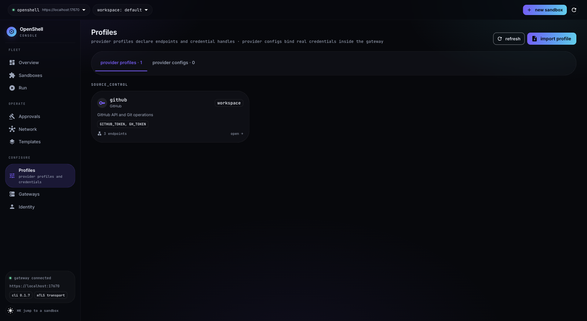 | 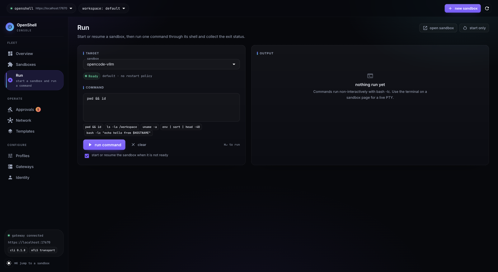 |

| Sandboxes | Terminal | Logs | Identity |
| --- | --- | --- | --- |
|  | 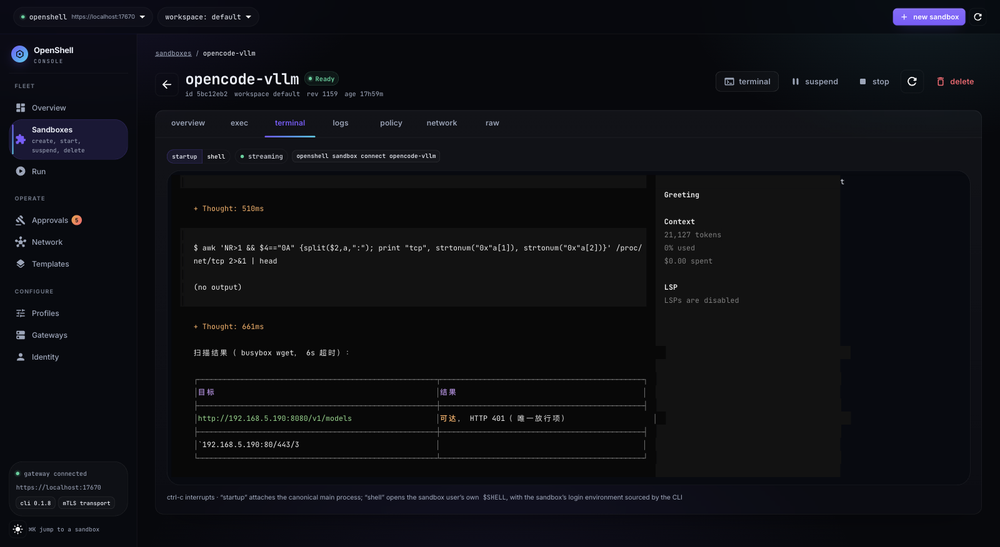 | 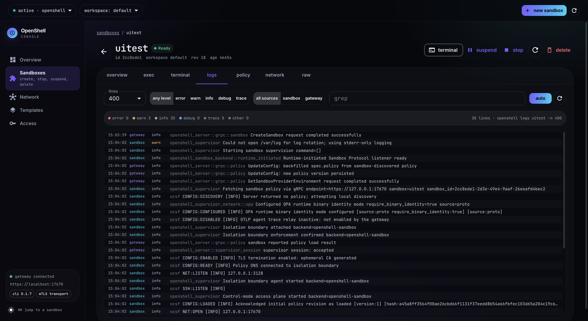 |  |

| Network | Templates |
| --- | --- |
| 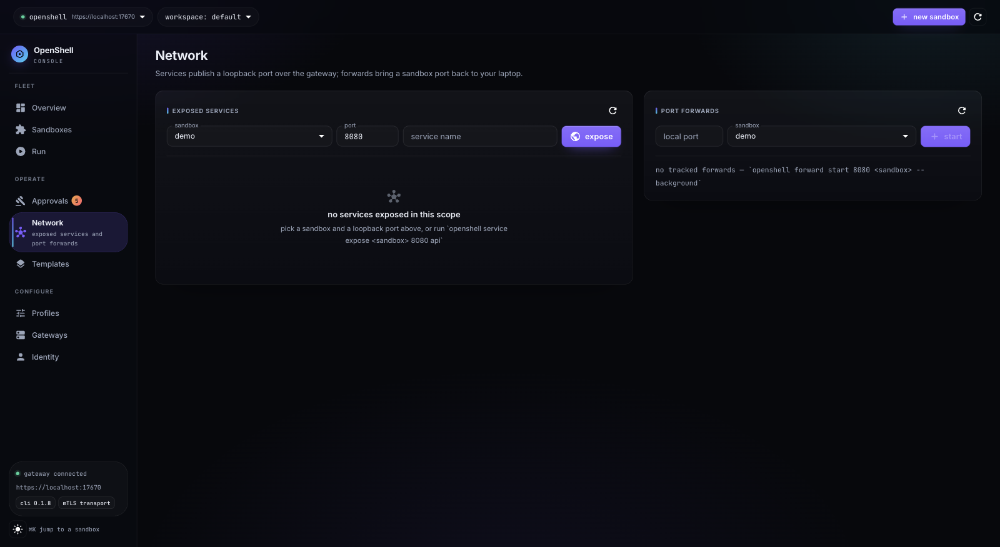 | 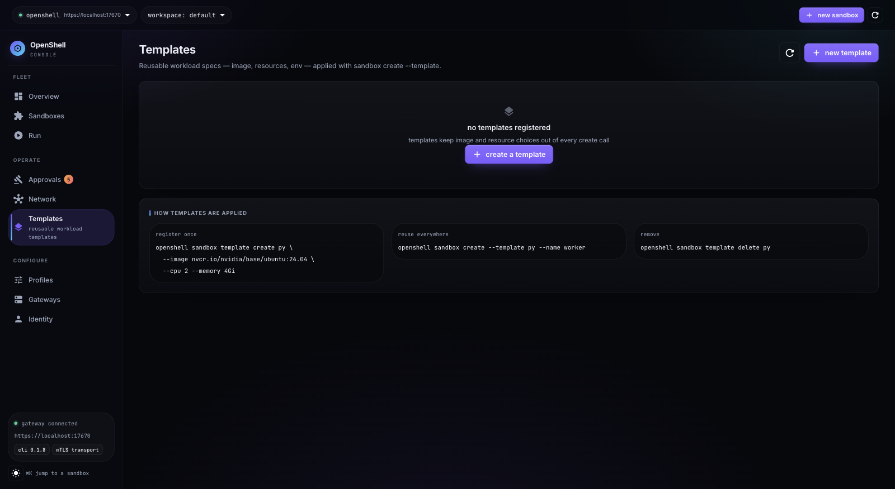 |

| Policy dialog (command pinned) | Policy removal confirm |
| --- | --- |
| 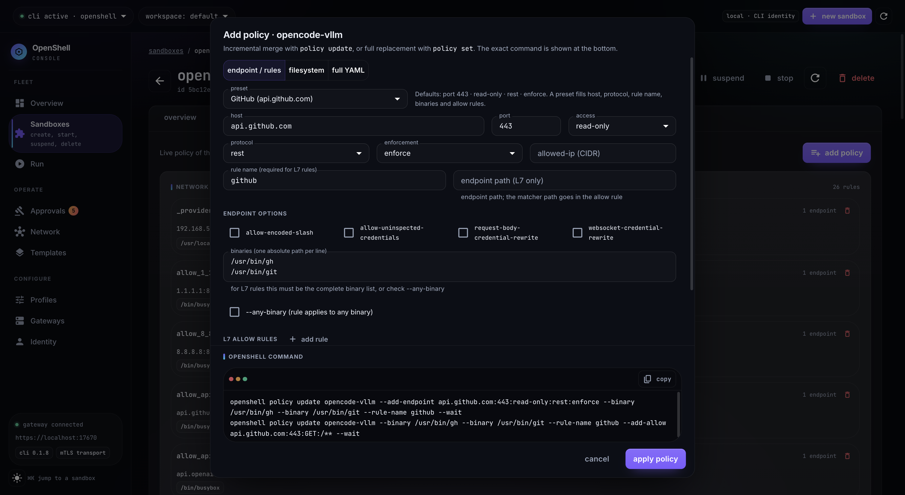 | 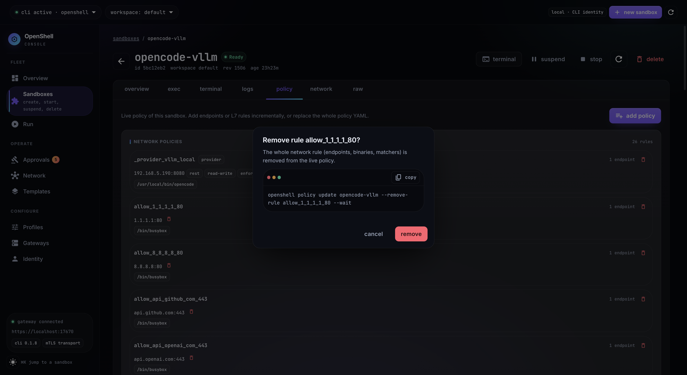 |

| Import: update-existing fallback | Provider create: declared keys |
| --- | --- |
| 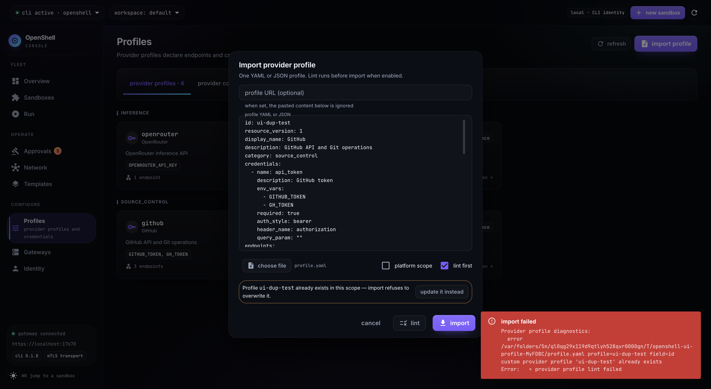 | 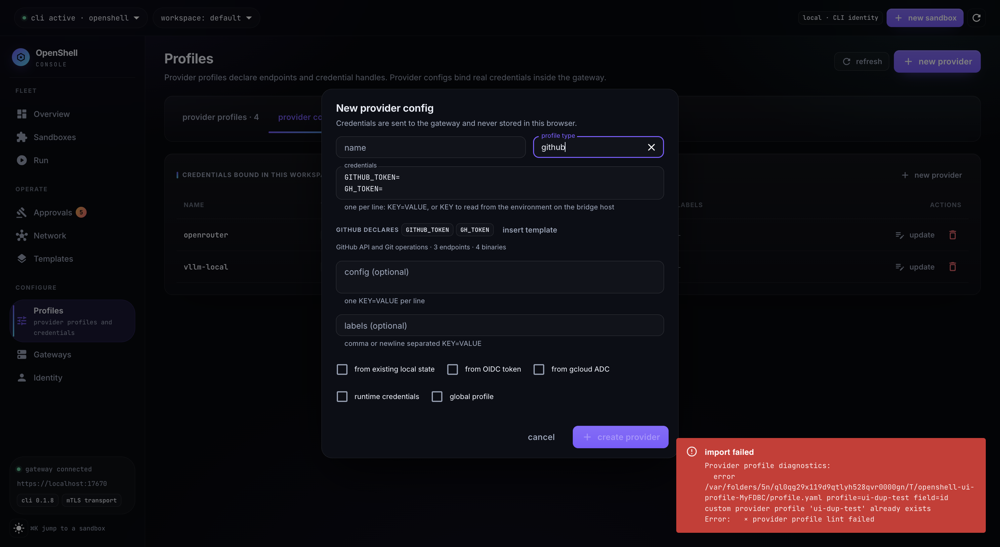 |

## Security notes

- In **local** mode the bridge binds `127.0.0.1` and has **no authentication layer of its
  own** — it inherits your CLI's mTLS identity and can run arbitrary commands in your
  sandboxes (exec/terminal). Do not expose the port to a network you do not trust, and do not
  put it behind a public proxy. Use **oidc** mode when other people share the machine.
- In **oidc** mode sessions are HttpOnly cookies; tokens never reach browser storage. The
  password grant is used only against the configured issuers.
- `exec`, **Run** and the terminal are intentionally powerful; treat them like a local shell.
- Gateway registration commands modify your local CLI config (`gateway add/select/remove`).
  Pasted edge/OIDC tokens travel only from the browser to this loopback bridge, are written
  with `0600` permissions alongside the CLI's own gateway metadata, and are never kept in
  `localStorage` or any browser storage.
- Token updates are verified with `openshell status`; adding a gateway with verification
  enabled rolls the registration back if the check fails.
- The console never reads back raw provider secrets; **Profiles** only shows profile metadata
  and provider config names/credential keys. Credential values are sent to the gateway and
  are not displayed again.
- All CLI arguments built from user input pass strict validators (no flag-like values, no
  whitespace/shell metacharacters); the bridge never interpolates input into a shell string.

## Contributing

Issues and PRs welcome — see [CONTRIBUTING.md](CONTRIBUTING.md). Run `npm run typecheck`,
`npm run build` and (against your own gateway) `npm run test:sweep` before submitting.

## License

[MIT](LICENSE)

## 中文快速开始

```bash
npm install
npm run demo          # 桥接 :8787 + Vite :5273（local 模式，免登录）
# 浏览器打开 http://localhost:5273，在欢迎页选择 Local console
```

要求：本机已安装 `openshell`（0.1.7/0.1.8 测试通过）且 `openshell status` 显示 `connected`；
Node.js 建议 22.6+（直接运行 TypeScript 桥接服务，无需编译）。
生产模式：`npm run build && npm start`，然后访问 http://127.0.0.1:8787。

OIDC 演示（多租户登录 + 角色权限）：

```bash
cd ~/docs/iam-lab && docker-compose up -d   # Keycloak + OpenLDAP 实验环境
npm run demo:oidc                           # :5273 需要 OIDC 登录
# 账号：admin/admin123（admin 角色）、user1/user1123（user 角色），realm tenant-a / tenant-b
```

Microsoft Entra ID 演示（授权码 + PKCE 重定向登录，MFA 由租户策略决定；设备码为备选）：

```bash
export OPENSHELL_UI_ENTRA_TENANT=<租户 ID 或域名>
export OPENSHELL_UI_ENTRA_CLIENT_ID=<应用注册的客户端 ID>
npm run demo:entra                          # :5273 OIDC 模式，欢迎页出现 Entra 登录卡片
# 欢迎页选 Entra ID → continue to Microsoft sign-in（跳转到微软登录页）；
# 输入受限场景可改用 use a device code instead；应用角色 admin/user 决定权限
```

完整演示步骤见 [docs/DEMO.md](docs/DEMO.md)；回归检查 `npm run test:sweep`（55 项，需真实网关）。

### 企业对接与启动

**只渲染已配置的登录路径**；非回环绑定且无任何凭据路径时拒绝启动（fail-closed）。
详细英文版见上文 *Enterprise onboarding*。

**Entra ID（推荐脚本一键）**：

```bash
brew install azure-cli && az login     # 租户管理员登录一次
node scripts/entra-setup.mjs           # 应用注册 + 公共客户端流 + admin/user 角色
                                       # + 测试用户 + 回调 URI（幂等），打印 env 与密码
export OPENSHELL_UI_ENTRA_TENANT=<脚本输出的 tenant>
export OPENSHELL_UI_ENTRA_CLIENT_ID=<脚本输出的 client>
npm run demo:entra                     # 开发；生产：npm run build && OPENSHELL_UI_AUTH=oidc npm start
```

手动对接要点：应用注册 → *Allow public client flows = Yes*；把
`<控制台 origin>/api/auth/oidc/callback` 加进公共客户端 redirect URIs（每个 serving origin
都要加）；建 `admin`/`user` 应用角色并给账号分配。

**OIDC / Keycloak**：IdP 侧建公共客户端（授权码 + PKCE），注册同上回调 URI；控制台侧：

```bash
export OPENSHELL_UI_AUTH=oidc
export OPENSHELL_UI_OIDC_ISSUERS="Production=https://idp.example.com/realms/prod"
export OPENSHELL_UI_OIDC_CLIENT_ID=<客户端 ID>
npm run build && npm start
```

无内置默认 issuer：不设 = 不显示 OIDC 入口。登录在 IdP 自己的页面完成（MFA/SSO/联邦），
控制台不接触密码；token 服务端 JWKS 验签。

**Operator 凭据（bot/CI/k8s）**：`OPENSHELL_UI_LOCAL_TOKEN[_FILE]`（Secret 挂载，常数时间
比较 + 限流）和/或 mTLS（`TLS_CERT/KEY` + `TLS_CLIENT_CA`），均为 admin 角色。

**启动矩阵**：`npm run demo`（本地免登录，仅回环）· `npm run demo:oidc`（lab）·
`npm run demo:entra` · `npm run build && npm start`（单进程生产）·
`docker build -t openshell-console . && docker run -p 8787:8787 -e …`（必须配凭据）·
k8s 见 [docs/DEPLOY-K8S.md](docs/DEPLOY-K8S.md)。

**生产清单**：每个 IdP 注册回调 URI； ingress 后设 `OPENSHELL_UI_PUBLIC_URL`；桥接自终止 TLS
或 ingress re-encrypt（否则丢 mTLS 验证）；单副本；轮换 Secret 用 rollout restart；
`OPENSHELL_UI_REQUIRE_AUTH=1` 可关掉回环免登录便利。

> local 模式桥接监听 127.0.0.1、不额外鉴权，使用的是你本机 CLI 的 mTLS 身份，且能执行任意
> 沙箱命令（exec / 终端）。不要把端口暴露到不受信任的网络；多人共用机器请用 oidc 模式。
