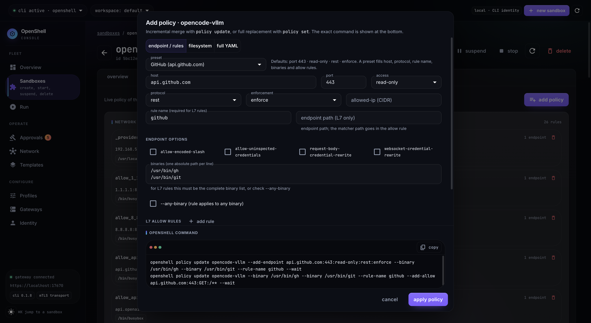
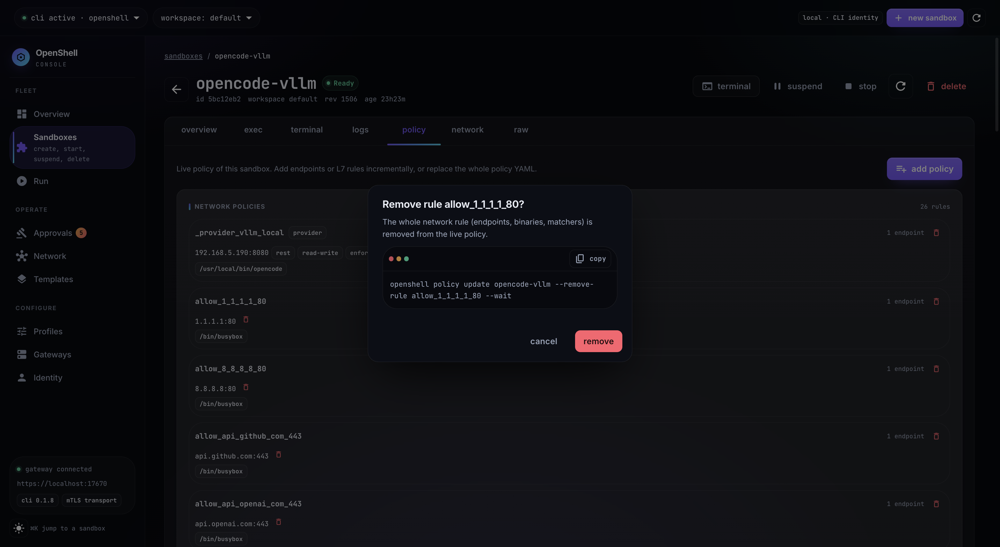
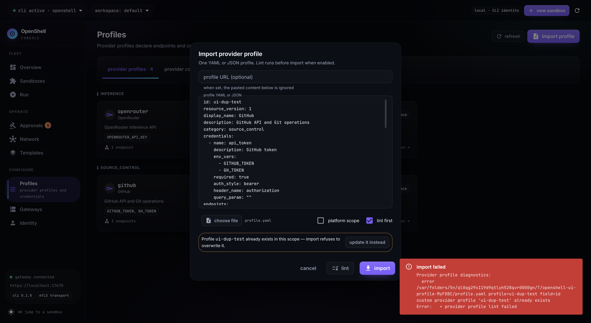
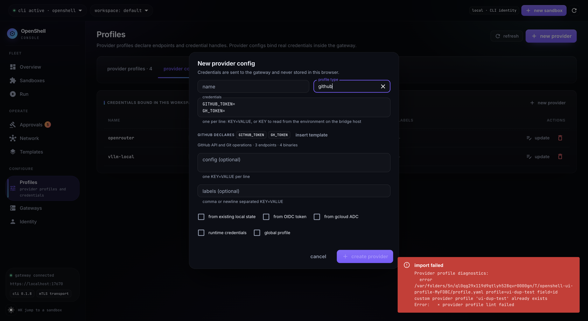

# Demo guide

Three ways to demo the console: **local mode** (5 minutes, needs only the
OpenShell CLI + a gateway), **OIDC mode** (adds the IAM lab: Keycloak +
OpenLDAP, multi-tenant sign-in with role-based permissions), and **Microsoft
Entra ID** (device-code sign-in against a real Entra tenant, MFA-friendly).

---

## 0. Prerequisites

| Need | For | Check |
| --- | --- | --- |
| Node.js ≥ 22.6 | everything | `node --version` |
| `openshell` CLI + reachable gateway | everything | `openshell status` → `connected` |
| Docker / colima + the IAM lab | OIDC demo only | `curl -s http://localhost:8080/realms/tenant-a/.well-known/openid-configuration` |

No gateway yet? Any local OpenShell gateway works, e.g. one started by the
OpenShell CLI itself; register it with `openshell gateway add …` first.

---

## 1. Local demo (5 minutes)

```bash
npm install
npm run demo                 # bridge :8787 + web :5273, local mode
open http://localhost:5273
```

You land on the **welcome page** (choose how to enter). Pick
**Local console → enter local console**: no sign-in, everything runs with your
CLI's mTLS identity.

> This anonymous entry is a **development convenience**: it exists only while the
> bridge is in `local` mode, bound to loopback, with no operator token / client CA
> configured and `OPENSHELL_UI_REQUIRE_AUTH` unset. Configure any credential (or
> bind non-loopback) and the local card demands a token or a verified client
> certificate instead — see [DEPLOY-K8S.md](DEPLOY-K8S.md) for the production model.

Walkthrough (≈5 min):

1. **Overview** — gateway health, fleet counts per phase, recent sandboxes,
   failures that need attention. Switch gateway/workspace in the header; every
   page follows the scope. `⌘K` jumps to any sandbox.
2. **Sandboxes → new** — create from an image (e.g.
   `nvcr.io/nvidia/base/ubuntu:24.04`) with a main process like `sleep 30000`,
   cpu/memory, env, providers. Watch it reach `Ready`.
3. **Sandbox detail → terminal** — two modes:
   - `startup` attaches the sandbox's **canonical main process** (the command it
     was started with) via `openshell sandbox connect`;
   - `shell` opens the sandbox user's own `$SHELL` (never a hardcoded bash).
   Sessions survive tab/page switches; “end session” kills one.
4. **Run** — one-off commands with exit code + duration; the target panel shows
   the sandbox's observed **startup command** with a “use” button; tips explain
   login-env sourcing, shell syntax, providers and default-deny networking.
5. **Approvals** — make the sandbox attempt a denied connection
   (`exec 3<>/dev/tcp/example.com/443`), enable
   `agent_policy_proposals_enabled` in the sandbox **settings** panel, and watch
   the proposed rule appear; approve / reject with a reason / approve-all /
   history. The nav badge counts pending rules.
6. **Policy → add policy** — three modes:
   - *endpoint / rules*: presets (GitHub/OpenAI/Anthropic/…), endpoint options as
     checkboxes, L7 allow rows; the dialog shows the exact `openshell` commands
     (two sequential updates when endpoint + L7 are combined) and supports
     `--dry-run`;
   - *filesystem*: read-only/read-write paths, include-workdir, landlock — merged
     into the live policy with `policy set`;
   - *full YAML*: replace everything.
   The **network policies** panel shows the result immediately
   (). Removal works at three
   levels from that panel: the rule's trash icon (`--remove-rule`), each endpoint's trash
   icon (`--remove-endpoint`), and the ✕ on any allow/deny matcher chip (rewrites the policy
   without that matcher via `policy set`). Each asks for confirmation and shows the command
   ().
7. **Network / Templates / Profiles** — expose a loopback service, start a port
   forward, register a workload template, browse/import/lint provider profiles
   and create provider configs (credentials stay in the gateway). Importing a profile
   whose id already exists shows the gateway diagnostics and offers **update it instead**
   ();
   the provider dialog lists the keys the selected profile declares, can insert a
   `KEY=` template, and blocks unknown credential keys before submit
   ().
8. **Gateways** — health-check every registered gateway, switch scope, add a new
   one (local mTLS / remote SSH / plaintext / edge token / OIDC), with
   verification and automatic rollback on failure.

Regression check afterwards:

```bash
npm run test:sweep           # 56 checks against the live bridge + gateway
# if :8787 runs in OIDC mode, point the sweep at a local-mode bridge instead:
SWEEP_BRIDGE=http://127.0.0.1:8802 npm run test:sweep
```

---

## 2. OIDC demo (IAM lab)

Bring up the lab (Keycloak 26 + OpenLDAP, two LDAP-federated realms):

```bash
cd ~/docs/iam-lab            # or wherever your iam-lab checkout lives
colima start                 # if you use colima
docker-compose up -d
# wait until healthy:
docker-compose ps
```

Lab accounts (per realm `tenant-a` / `tenant-b`):

| User | Password | Realm role |
| --- | --- | --- |
| admin | admin123 | admin |
| user1 | user1123 | user |
| user2 | user2123 | user |

Run the console in OIDC mode (second terminal pair, or replace the local one):

```bash
npm run demo:oidc            # bridge :8787 with OPENSHELL_UI_AUTH=oidc + web :5273
open http://localhost:5273
```

Now the welcome page gates entry:

1. **Sign in with OIDC** → *Lab realm A* (the Keycloak realm `tenant-a`; the
   display name comes from the `Display Name=url` issuer syntax) → *continue to
   sign-in* redirects to the Keycloak login page (authorization code + PKCE —
   the console never sees the password). Enter `admin / admin123` **there** →
   back on the console with an `admin · admin` chip in the header.
2. Everything from the local walkthrough works; additionally try the
   **Gateways → add gateway → OIDC** flow: issuer
   `http://localhost:8080/realms/tenant-a`, and either paste a token or use
   *fetch a token with a password grant* (`lab-cli`, admin/admin123).
3. Sign out (header icon) and sign in as `user1 / user1123`: reads, exec, Run and
   terminal work; deletions, gateway management, policy/settings/approval
   mutations return **403** with a clear toast.
4. Switch realm to `tenant-b` to show tenant isolation (same usernames,
   different directory).
5. Sign out → API calls and the terminal socket now return 401 / an auth error
   frame; the welcome page is the only thing reachable.

Keep a **local-mode** console side by side for comparison:

```bash
OPENSHELL_UI_PORT=8802 npm run dev:server     # local bridge :8802
OPENSHELL_UI_API=http://127.0.0.1:8802 npx vite --port 5279
open http://localhost:5279                    # no sign-in; header chip says local
```

The welcome page on either console links to the other
(`OPENSHELL_UI_LOCAL_URL` / `OPENSHELL_UI_OIDC_URL` configure the links).

---

## 3. Microsoft Entra ID demo (device-code flow)

Needs an Entra tenant where you can register an application (any work/school
tenant, or a free [Microsoft 365 developer](https://developer.microsoft.com/microsoft-365/dev-program)
tenant). No client secret, no redirect URI — the console uses the OAuth
device-code flow, so MFA and conditional access work as configured.

### 3.1 One-time Entra setup

**Automated** (Azure CLI, needs `az login` as tenant admin):

```bash
brew install azure-cli && az login        # one interactive sign-in
node scripts/entra-setup.mjs              # app + roles + test users, idempotent
# security defaults block device-code sign-in; on a disposable test tenant:
node scripts/entra-setup.mjs --disable-security-defaults
```

The script prints the env exports and the generated test-account passwords
(also saved to gitignored `.entra-test-accounts.json`). Or do it by hand:

1. **Register an app**: Entra admin center → *App registrations* → *New registration*.
   - Name: `openshell-console`; supported account types: single tenant (or
     multitenant if you want guests).
   - No redirect URI needed.
2. **Allow public client flows**: *Authentication* → *Advanced settings* →
   **Allow public client flows = Yes** (this enables the device-code grant).
3. **Define app roles** (optional but recommended, mirrors the Keycloak demo):
   *App roles* → create `admin` and `user` (allowed member types: Users/Groups,
   value = the role name). Then under *Enterprise applications* → your app →
   *Users and groups*, assign your test users the `admin` / `user` role.
   Roles arrive in the token's `roles` claim; `admin` unlocks destructive
   operations, exactly like the Keycloak realm role.
4. Note the **Application (client) ID** and **Directory (tenant) ID** from the
   app's *Overview* page.

### 3.2 Run the console

```bash
export OPENSHELL_UI_ENTRA_TENANT=<tenant-id-or-domain>
export OPENSHELL_UI_ENTRA_CLIENT_ID=<client-id>
npm run demo:entra           # OPENSHELL_UI_AUTH=oidc bridge :8787 + web :5273
open http://localhost:5273
```

The welcome page now shows a configured **Microsoft Entra ID** card:

1. Click **sign in with device code** — the console requests a code from your
   tenant and displays it with a countdown.
2. **Open verification page** (`microsoft.com/devicelogin`), enter the code,
   sign in with your Entra account and approve (MFA prompt if your tenant
   requires it).
3. The bridge polls the token endpoint; on approval you enter the console with
   your name and roles in the header chip. Sessions are HttpOnly cookies;
   tokens stay server-side and refresh lazily via `offline_access`.

Role checks to demo: a user without the `admin` app role gets **403** on
deletions, gateway management, policy/settings/approval mutations; reads, exec,
Run and terminal work. Without any role assignment everyone is a non-admin
(the `roles` claim is simply absent).

Useful variants:

- `OPENSHELL_UI_ENTRA_SCOPES` — defaults to `openid profile email offline_access <clientId>/.default`.
  The `<clientId>/.default` scope is what makes the access token's audience the app itself,
  so Entra includes your app roles in the `roles` claim (a Graph-audience token would not);
- `OPENSHELL_UI_ENTRA_ISSUER` — override for sovereign clouds
  (e.g. `https://login.partner.microsoftonline.cn/<tenant>/v2.0`);
- `OPENSHELL_UI_ADMIN_ROLE` — rename the admin role (default `admin`).

Keycloak and Entra can be enabled on the same bridge: the welcome page offers
both, and sessions/role gating are identical regardless of the path taken.

---

## 4. Operator credentials demo (token / mTLS)

The **Operator** card on the welcome page adapts to what the bridge has configured:
a token field when `OPENSHELL_UI_LOCAL_TOKEN[_FILE]` is set, a *continue with client
certificate* button when TLS + client CA are set, both when both are set.

### 4.1 Token

```bash
export OPENSHELL_UI_LOCAL_TOKEN=$(openssl rand -hex 16)   # print it, then:
npm run dev:server:entra        # or any oidc/local bridge with the env set
```

Welcome → **Operator** → paste the token → **unlock**. You enter as `local-operator`
with the admin role (`issuer: urn:openshell:local:token`). Wrong tokens are rate
limited (5 failures/min/source); the token is never logged. In k8s mount it from a
Secret via `OPENSHELL_UI_LOCAL_TOKEN_FILE`.

**Where it comes from:** nowhere external — you generate it (`openssl rand -hex 32`) and
inject it at bridge startup; it is a pre-shared secret, not an IdP-issued JWT (no issuer,
no expiry, possession = admin). Rotate/revoke by replacing the Secret and doing a rollout
restart (the value is read at startup). All holders share the `local-operator` identity, so
this path is for bots/CI/break-glass; humans use OIDC/Entra. Full lifecycle and the
token-vs-JWT comparison: README → *Enterprise onboarding → Operator credentials*.

### 4.2 mTLS (client certificate)

```bash
# one-time test PKI (production: your cluster CA / cert-manager)
mkdir -p /tmp/os-mtls && cd /tmp/os-mtls
openssl req -x509 -newkey rsa:2048 -nodes -keyout ca.key -out ca.crt -days 30 -subj "/CN=os-test-ca"
openssl req -newkey rsa:2048 -nodes -keyout server.key -out server.csr -subj "/CN=localhost"
printf "subjectAltName=DNS:localhost,IP:127.0.0.1" > san.ext
openssl x509 -req -in server.csr -CA ca.crt -CAkey ca.key -CAcreateserial -out server.crt -days 30 -extfile san.ext
openssl req -newkey rsa:2048 -nodes -keyout client.key -out client.csr -subj "/CN=openshell-operator"
openssl x509 -req -in client.csr -CA ca.crt -CAkey ca.key -CAcreateserial -out client.crt -days 30

OPENSHELL_UI_PORT=8909 OPENSHELL_UI_AUTH=local \
OPENSHELL_UI_TLS_CERT=$PWD/server.crt OPENSHELL_UI_TLS_KEY=$PWD/server.key \
OPENSHELL_UI_TLS_CLIENT_CA=$PWD/ca.crt node server/index.ts
```

The certificate **is** the login — no button needed for API clients:

```bash
curl --cacert ca.crt https://127.0.0.1:8909/api/auth/me          # → user: null (401 on data routes)
curl --cacert ca.crt --cert client.crt --key client.key \
     https://127.0.0.1:8909/api/auth/me                          # → openshell-operator · admin
```

A cert that does not chain to the client CA is rejected even if TLS handshake
succeeds. The session is keyed by the cert fingerprint and re-verified on every
request, so revoking/removing the cert ends access immediately.

**Browser:** import the client cert into your OS trust store, then open the https
URL — Chrome presents its certificate picker once; after that the session is
automatic and the Operator card's *continue with client certificate* button just
confirms it:

```bash
openssl pkcs12 -export -in client.crt -inkey client.key -out operator.p12 -passout pass:openshell
security import operator.p12 -k ~/Library/Keychains/login.keychain-db -P openshell   # macOS
# trust ca.crt for the server side too (test PKI is self-signed):
security add-trusted-cert -d -r trustRoot -k ~/Library/Keychains/login.keychain-db ca.crt
```

(Linux/Windows: import the p12 into the browser/OS certificate store equivalently.)

**Reusing the gateway PKI.** The test PKI above is separate from the gateway's. If you want
console operators to authenticate with the *same* certificates the CLI uses against the
gateway, point the console at the gateway CA and client pair instead:

```bash
G=~/.config/openshell/gateways/openshell/mtls
OPENSHELL_UI_TLS_CLIENT_CA=$G/ca.crt ...   # client cert = $G/tls.crt + tls.key → CN=openshell-client
```

The console server cert must then chain to that CA with proper SANs (the gateway's own
`tls.crt` is a *client* cert — don't serve it). Production extraction/mount of the gateway
credentials into k8s, and the trust implications of one shared PKI:
[DEPLOY-K8S.md](DEPLOY-K8S.md) §2b.

---

## 5. Production single process

```bash
npm run build
OPENSHELL_UI_AUTH=oidc npm start   # or without the env for local mode
open http://127.0.0.1:8787
```

The bridge serves `dist/` and the API from one loopback port.

---

## Troubleshooting

| Symptom | Cause / fix |
| --- | --- |
| `openshell binary not found` | CLI not on `PATH`; set `OPENSHELL_BIN` |
| gateway `unreachable` in header | gateway down or wrong scope; pick another gateway in the header |
| `compute driver does not support sandbox suspend` | your driver (e.g. vm) lacks suspend/resume; stop/start instead |
| `filesystem read_only path '/usr' cannot be removed on a live sandbox` | gateway protects base read-only paths while running; keep them |
| `--add-endpoint cannot be combined with --add-allow` | you called the CLI by hand; the console splits these into two updates automatically |
| OIDC `invalid_grant` | wrong realm/password, or LDAP container not healthy yet |
| Entra `AADSTS700016` (app not found) | wrong client id, or the app lives in a different tenant than `OPENSHELL_UI_ENTRA_TENANT` |
| Entra `AADSTS7000218` / `invalid_client` | *Allow public client flows* is off in the app registration (Authentication → Advanced settings) |
| Entra `AADSTS50194` / tenant not found | single-tenant app used with a different tenant; use the app's own tenant id |
| Entra `AADSTS650057` (invalid resource) | the app requests a token for itself (`<clientId>/.default`) but doesn't list itself in *requiredResourceAccess*; re-run `scripts/entra-setup.mjs` (exposes `access_as_user` and adds the self permission) |
| Entra sign-in works but `roles` is empty | token audience is Microsoft Graph, not the app — keep `<clientId>/.default` in `OPENSHELL_UI_ENTRA_SCOPES` |
| Entra sign-in approved but no admin rights | user has no `admin` app role assignment (Enterprise applications → Users and groups), or `OPENSHELL_UI_ADMIN_ROLE` doesn't match the role value |
| port already in use | `OPENSHELL_UI_PORT` / `vite --port` to move |
